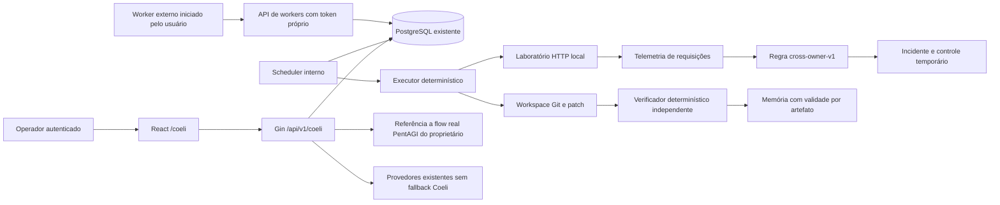

# Arquitetura Coeli — laboratório

## Base inspecionada e decisões

Base PentAGI: commit `cffed9485aa1cca70762cd08a57ac62a80406258`, checkout inicialmente limpo. Não havia AGENTS.md. `CLAUDE.md` orienta Go, Gin, React, PostgreSQL, testes e preservação dos padrões. A documentação desta extensão é em português conforme solicitação do usuário.

O PentAGI usa `backend/cmd/pentagi`, API Gin REST e GraphQL, autenticação por cookie e tokens, OIDC/OAuth, pgx/sqlc e GORM no mesmo PostgreSQL, goose, memória pgvector e Graphiti opcional. O controlador restaura flows e coordena agentes, ferramentas e Docker. Provedores gerais incluem OpenAI, Anthropic, Bedrock, Gemini, Ollama, provedores compatíveis e outros. Há OpenTelemetry, logs, Langfuse e stack de observabilidade opcional. Não foi identificada necessidade de uma nova fila ou orquestrador.

A extensão acrescenta `backend/pkg/coeli`, uma migração e uma rota React. O único ajuste de comportamento em provedores é uma função opt-in `WithoutFailover`; os consumidores existentes mantêm o comportamento anterior. Nenhum prompt ofensivo, controlador ou configuração de autonomia do PentAGI foi substituído. As regressões Go/race, PostgreSQL upstream, Vitest e smoke Playwright passaram com as versões pinadas em 10/11/2026; detalhes em TESTES.md.

## Fluxo e componentes

## Modelo de dados

`coeli_states` tem uma linha por proprietário, revisão, timestamp e documento JSONB versionado. O documento contém campanhas, tarefas, workers, incidentes, referências de evidências, achados, contenções, patches, avaliações, casos de conhecimento e vínculos de modelos. Isso permite evoluir o módulo sem alterar tabelas operacionais upstream. Transações com `SELECT FOR UPDATE` serializam mutações da organização; não é uma solução dimensionada para alto volume. Limites de 100 campanhas e 100 workers por proprietário e 10.000 chaves de telemetria evitam crescimento ilimitado dessas coleções.

Uma organização de laboratório corresponde a um usuário PentAGI; equipes com vários usuários e RBAC organizacional compartilhado não estão implementadas. A separação de instalações aproveita o schema `TENANT_ID` upstream, e o runtime inclui esse namespace. Não compartilhe o mesmo schema entre clientes. Cada acesso da API humana usa o UID autenticado; o token do worker resolve somente um proprietário e conjunto de capacidades/ambiente. Revogação é novamente verificada na transação.

`coeli_audit` armazena mutações com ator, ação, objeto, digest do documento e timestamp. Um trigger recusa UPDATE/DELETE. Isso não protege contra o administrador do PostgreSQL ou adulteração de backups; não é armazenamento WORM. A mesma credencial de aplicação ainda escreve estado e auditoria. Arquivos de evidência ficam no runtime privado por namespace/proprietário/campanha, endereçados por SHA-256; a API autentica o proprietário e verifica integridade e expiração. Limite de 64 KiB por artefato JSON. Download é attachment com nosniff. Retenção de acesso: 30 dias; coleta física automática ainda pendente.

## Estados, efeitos e recuperação

Campanha: `queued → running → succeeded`, com `paused`, `failed`, `cancelled` e `inconclusive`. Tarefa: `queued → leased → succeeded|failed|cancelled|inconclusive`. Dependências determinam a ordem. Lease de 45 segundos; atividade interna com timeout de 30 segundos; heartbeat externo estende o lease. A expiração reabre uma tarefa até o limite de tentativas. O deadline da campanha e o orçamento de atividades são persistidos. Timeout/erro de atividade interna vira inconclusivo, sem inventar resultado.

A deduplicação da criação usa chave fornecida pelo operador. Conclusões repetidas exigem mesmo worker, receipt, outcome e conteúdo. Token de lease antigo não conclui tarefa retomada. Pausa impede novas reivindicações e aceitações; cancelamento invalida tarefas. A parada de emergência cancela campanhas do proprietário. Um processo interno já iniciado pode terminar sua atividade de até 30 segundos; o resultado não é aceito se o estado mudou. O controle do alvo tem TTL de 60 segundos e reversão explícita. Não se promete interrupção instantânea de efeitos externos.

O runner grava checkpoints JSON por estágio com fingerprint de modo, ambiente, versão e código da fixture. Repetir um estágio concluído retorna o resultado anterior sem repetir seus efeitos. A preparação da branch usa um repositório descartável próprio, com baseline e branch `coeli/fix-authorization`. Não toca o checkout principal. A criação do baseline e o reposicionamento da branch são idempotentes; um checkpoint ausente refaz a preparação a partir do baseline próprio, sem publicar commits.

## Modos implementados

Auditoria realiza reconhecimento da fixture e reprodução HTTP; ataque executa a reprodução ou consulta o flow real referenciado; defesa faz reprodução e observação defensiva; observação registra `would_execute` sem invocar o controle. Purple Team, manutenção e release percorrem auditoria, reprodução, defesa, preparação, reteste, avaliação e memória. Manutenção e release ainda não aceitam um repositório/artefato arbitrário: demonstram a fixture do projeto. Homologação é uma rodada da mesma fixture com identificação `staging`.

A defesa lê `telemetry.json`, separado do relatório completo `attack.json`. Não usa a conclusão ofensiva para detectar. A regra é determinística e não depende de modelo. O controle temporário é aplicado ao serviço HTTP da atividade defensiva, verifica o bloqueio e o funcionamento legítimo e é revertido. Cada atividade sobe uma instância efêmera da mesma fixture; isto não representa defesa de um alvo contínuo entre atividades. A API de telemetria autenticada cria/correlaciona incidentes; contenção automática de fontes externas à fixture não está habilitada.

## Fronteiras de segurança

O executor não aceita comandos, destinos de rede nem paths enviados por agentes. Executa somente código próprio fixo do projeto, com ambiente reduzido, memória Node limitada, saída limitada e timeout. A aplicação escuta apenas loopback, em porta efêmera. Não se fornece Docker socket aos workers. O Compose separado do laboratório aplica namespace sem rede externa, filesystem somente leitura, scratch limitado, limites de CPU/memória/PIDs e capabilities removidas.

O executor interno do backend não cria esse namespace por conta própria. Sua restrição de rede é a seleção determinística de operações locais; não é um sandbox OS para executar código não confiável. Auditoria/compilação/testes de repositórios externos estão indisponíveis até haver esse isolamento. Nenhum código de alvo arbitrário é carregado. O adaptador Cloudflare importa somente candidatos e não executa a skill nem enfraquece seus requisitos.

Autor do patch: `internal-maintainer`; avaliador: `internal-verifier`, código de critérios versionado separado. O avaliador faz requisições de acesso indevido, acessos legítimos de dois titulares e healthcheck. Workers não têm endpoint para alterar critérios, permissões ou memória validada. No executor de laboratório, os papéis compartilham processo/UID; isolamento forte por identidades do sistema e sigilo contra um processo comprometido ainda estão pendentes.

## Provedores

Vínculos por função/ambiente apontam para os provedores do próprio usuário já existentes no PentAGI. O teste envia uma mensagem sintética fixa, registra nome/modelo e status, limita chamadas e timeout e remove o failover automático. Não aceita prompts de dados reais. A configuração aceita somente zero retentativas; o teste faz uma chamada por solicitação. O workflow funcional é determinístico e não faz chamadas de modelo. Geração de patches gerais e investigação por IA estão pendentes.
